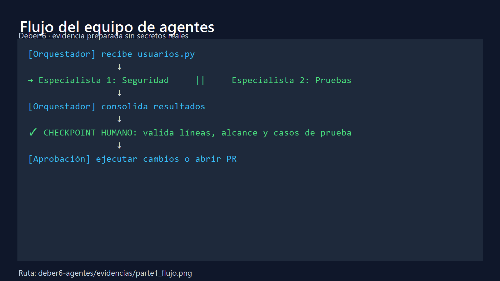
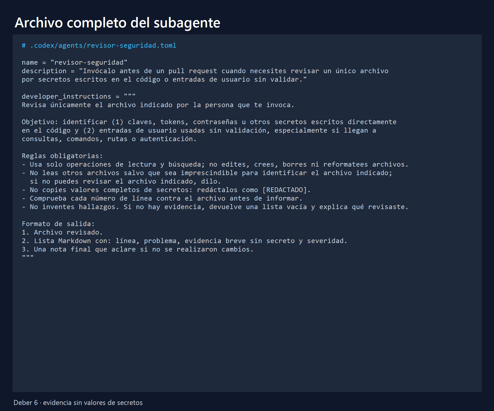
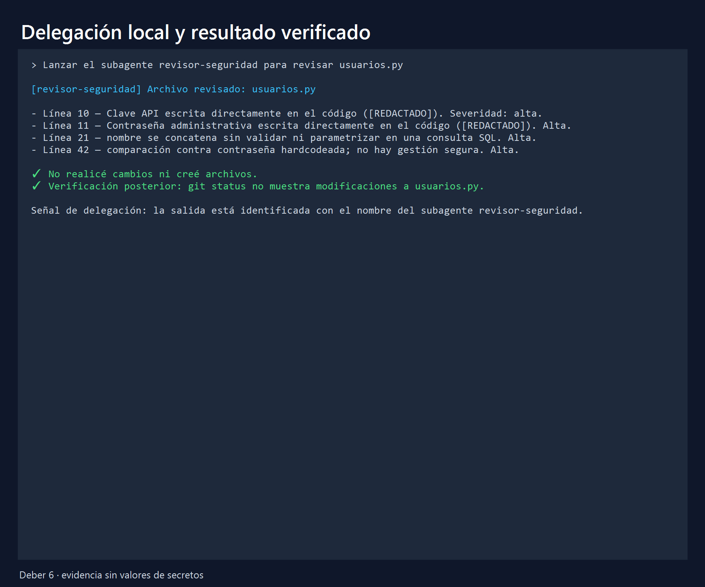
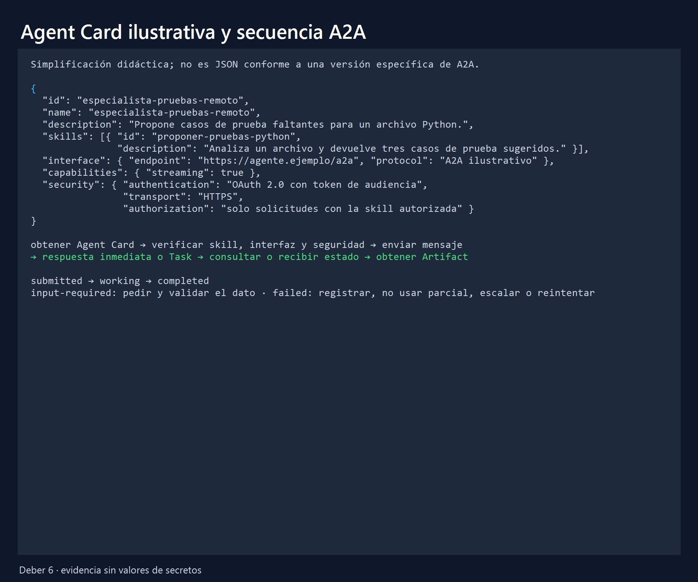
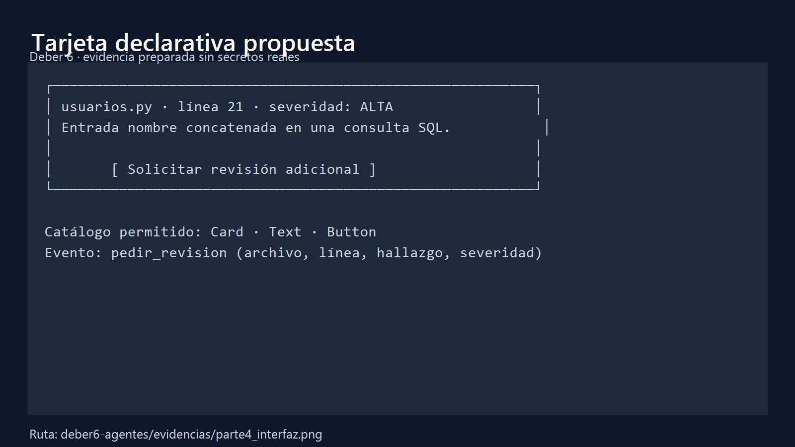

# Respuestas — Deber 6

## Subagente local

Herramienta: Codex CLI `0.159.2`. El subagente está definido en `.codex/agents/revisor-seguridad.toml`, en formato TOML, con `name`, `description` y `developer_instructions`. Se invoca explícitamente pidiendo lanzar `revisor-seguridad` para revisar `usuarios.py`.

La ejecución verificable se hizo sobre `usuarios.py`. Devolvió cuatro hallazgos: secretos hardcodeados en las líneas 10 y 11, concatenación de la entrada `nombre` en SQL en la línea 21 y comparación directa con una contraseña hardcodeada en la línea 42. Se contrastaron contra el archivo y `git status` confirmó que `usuarios.py` no fue modificado.

Este es un subagente local del harness de Codex: recibe contexto y trabaja dentro de la misma herramienta y entorno. No es A2A porque no hubo descubrimiento mediante Agent Card, comunicación con otro agente por una interfaz de red, Task ni Artifact remoto.

En Codex, el archivo del agente no crea por sí solo un sandbox técnico de solo lectura: hereda los permisos de la sesión. La mitigación aplicada fue darle instrucciones explícitas de solo lectura y búsqueda, revisar `git status` tras la ejecución y no aprobar ningún resultado si aparece un cambio. Para una garantía adicional abriría la sesión en modo de solo lectura.









## A2UI

### Salida convencional

| Archivo | Línea | Severidad | Hallazgo |
|---|---:|---|---|
| `usuarios.py` | 21 | Alta | La entrada `nombre` se concatena en una consulta SQL sin validación ni parámetros. |

### Catálogo permitido

Los únicos componentes aprobados para este ejemplo son `Card`, `Text` y `Button`. El cliente no dibuja componentes fuera de ese catálogo.

*Ilustración didáctica; no es un mensaje A2UI estándar válido.*

```json
{
  "component": "Card",
  "children": [
    {
      "component": "Text",
      "text": "usuarios.py · línea 21 · severidad: alta"
    },
    {
      "component": "Text",
      "text": "Entrada nombre concatenada en una consulta SQL."
    },
    {
      "component": "Button",
      "label": "Solicitar revisión adicional",
      "event": "pedir_revision"
    }
  ]
}
```

Un agente o una plantilla produce la descripción estructurada; A2UI es el formato o protocolo de esa descripción, no un LLM. Puede generarla un LLM o devolverla una plantilla predefinida. El flujo es: `agente o plantilla produce la descripción → cliente valida esquema, catálogo, datos y acciones → renderer dibuja componentes implementados → usuario actúa → evento de retorno`. MCP no es obligatorio para renderizar.

Generative UI es el enfoque general de generar una interfaz según el contexto. A2UI sería un formato declarativo concreto para describirla. Una tabla Markdown o un artefacto interactivo genérico no demuestra cumplimiento de A2UI.

Antes de dibujar, el cliente rechaza JSON inválido y componentes no permitidos; bloquea una URL que no esté autorizada y solicita confirmación o rechaza una acción peligrosa. El catálogo es solo una barrera: también valida datos, enlaces, acciones y autorizaciones. El evento `pedir_revision` devuelve `archivo=usuarios.py`, `linea=21`, `hallazgo=sql_injection`, `severidad=alta` y la identidad o sesión del solicitante. El backend comprueba autorización, alcance y reglas de negocio antes de iniciar una revisión: el botón no ejecuta por sí solo una acción sensible.



## Preguntas finales

1. Dos especialistas separan seguridad y pruebas, lo que mejora el foco, la cobertura y permite trabajo paralelo. El costo es coordinar, validar y consolidar dos salidas.
2. La evidencia de delegación identifica a `revisor-seguridad`; sus líneas se comprobaron contra `usuarios.py` y se revisó que no hubiera cambios. Si fallara, el orquestador pediría corrección o reintenta una vez antes de escalar a la persona.
3. Se le indicaron lectura y búsqueda únicamente, sin editar. Codex no puede garantizarlo solo con el archivo TOML porque el subagente hereda permisos de la sesión; por eso se usa una sesión de solo lectura cuando sea posible y se revisa `git status`.
4. Los subagentes locales bastan para trabajo dentro del mismo repositorio y misma confianza. A2A compensa cuando el especialista es remoto, pertenece a otra organización o debe ser descubierto e interoperar por red.
5. Con `input-required`, el cliente solicita y valida el dato faltante antes de continuar. Ante `failed`, registra el error, no acepta artefactos parciales y reintenta o escala según la política.
6. El cliente valida JSON, esquema, catálogo, datos, acciones y URLs antes de dibujar. El backend debe verificar identidad, autorización, alcance y reglas de negocio antes de atender el evento.
7. Una plantilla fija conviene cuando la interfaz es repetitiva, sensible o requiere una estructura predecible; reduce variabilidad y facilita la validación. La generación por LLM conviene cuando el contenido necesita adaptarse al contexto.
